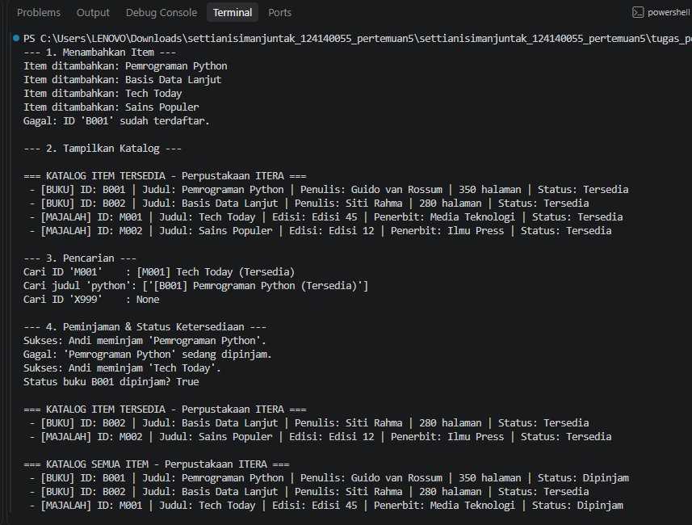
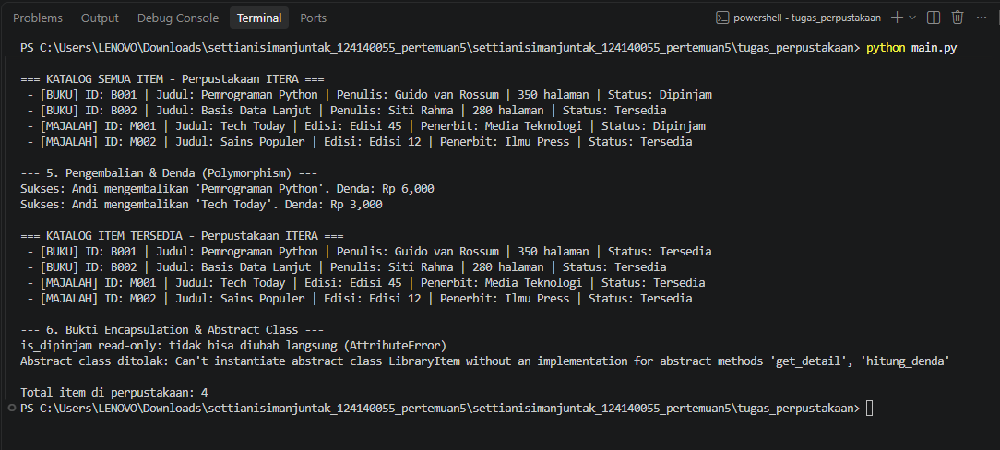

# Tugas Pertemuan 5 - Sistem Manajemen Perpustakaan Sederhana

## Identitas Mahasiswa
- **Nama Lengkap** : Settiani Simanjuntak
- **NIM**          : 124140055
- **Kelas Praktikum** : RA

## Deskripsi Program
Program ini mensimulasikan perpustakaan sederhana: menambah item, menampilkan katalog,
mencari item (berdasarkan judul atau ID), serta meminjam dan mengembalikan item dengan perhitungan denda.

Alur program (`main.py`): menambah buku & majalah -> menampilkan katalog -> mencari item ->
meminjam (status item berubah) -> mengembalikan + denda -> membuktikan encapsulation & abstract class.

### Penerapan Pilar OOP
| Pilar | Penerapan |
|---|---|
| **Class** | `LibraryItem`, `Book`, `Magazine`, `Member`, `Library` |
| **Inheritance** | `Book` dan `Magazine` mewarisi abstract class `LibraryItem` dan memanggil `super().__init__()` |
| **Encapsulation** | `__dipinjam` (private) di `LibraryItem`, `__koleksi` (private) di `Library`, `__daftar_pinjam` (private) di `Member`, `_judul`/`_item_id` (protected). Akses lewat `@property` dan method. |
| **Polymorphism** | `get_detail()` dan `hitung_denda()` di-override berbeda pada `Book` dan `Magazine`; `Library` dan `Member` memanggilnya tanpa `if-else` tipe. |
| **Abstraction** | `LibraryItem(ABC)` dengan `@abstractmethod` `get_detail()` dan `hitung_denda()` |

## Cara Menjalankan
```bash
cd tugas_perpustakaan
python main.py
```

## Screenshot Output
> Tempelkan screenshot terminal di sini (fitur tambah, cari, dan katalog).




